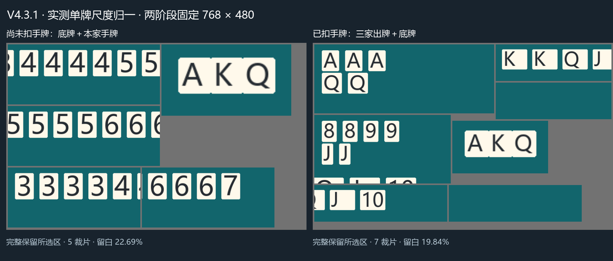

# V4.3.1 设计与验证：V3 开局、真实输入预览、实测尺度两阶段矩形拼图

更新：2026-10-27。这是当前行为的关键文档，替代 V4.3 的完整 17/20 张开局和五区方图方案。训练参数以本文为准；本次只推理验证，没有训练或替换权重。

## 1. 核对 V3，而非凭印象恢复

已直接读取 Git 历史 `origin/han_card_tracker_v3.0`，提交 `b1e4bd9` 中的 `core/games/doudizhu.py` 和 `core/base_tracker.py`。

V3 的有效帧门禁是底牌区非空；底牌连续 FRAME_LENGTH 帧内容相同才进入 HAS_STARTED，随后手牌连续 FRAME_LENGTH 帧内容相同进入 STARTED_RECORD_CARD，首次扣当时的手牌。没有要求三张底牌，也没有 17/20 张手牌门槛。V3 还存在空手牌连续一致也可开始记牌的漏洞。

按本次用户明确修改：

1. 底牌区出现任意一张牌，当前帧立即 WAIT_BEGIN → HAS_STARTED，不等三张、不同牌面也不要求相同。此时才刷新上一局显示，开始新局调试记录。
2. 非空合法手牌按 FRAME_LENGTH 连续稳定后，按实际数量扣一次，进入 STARTED_RECORD_CARD。五张、十六张等都允许；不再补扣后来变成二十张的差额，也不重复扣持续可见手牌。保留合法牌面数量检查，避免同点数超过整副牌数量。
3. 初始牌尚未确认时不记录出牌。底牌没有到上方区域、仍在画面中央的翻牌动画不会触发开局，也不会被记为上家出牌。
4. 之后本家出牌仅记历史，对手稳定出牌才扣剩余牌。底牌牌点本身不另扣一次。
5. 底牌区消失立即暂停记录，并打断未确认序列；已知为空连续至少 max(3, FRAME_LENGTH) 帧且持续 RESET_TIME 秒后内部结束。当前个人设置 3 秒，防止瞬间漏检误换局。其他区域有牌也不阻止结束；未知区域、截图/结果失败、暂停恢复中断连续性。尚在 HAS_STARTED 等手牌时也能结束。
6. 内部结束保留旧牌数和历史；下一次底牌出现开局才清旧显示并等待非空手牌稳定扣牌。显式重置仍立即清空。

自动模式先以窗口上方中央的几何先验识别底牌，排除中部翻牌；不按具体游戏名查区域表。可先发布底牌存在、进入 HAS_STARTED，再从任意非空手牌学习几何。几何未确认的出牌区保持未知，不补为空。原有常见“本家在下、两家在左右”的适用边界保留，不能从中途启动自动恢复此前历史。按 V3 放宽手牌数量后，稳定漏检仍可能导致初始扣牌少于真实张数；这是检测质量问题，不能暗中恢复 17/20 门槛。

## 2. 两阶段的界线是“初始手牌已扣除”

自动布局继续整图推理。手动布局按 Tracker 状态选择：

| 状态 | 实际裁剪区域 | 不参与区域 |
|---|---|---|
| WAIT_BEGIN 或 HAS_STARTED | 底牌、本家手牌 | 三家出牌 |
| STARTED_RECORD_CARD | 底牌、上家出牌、下家出牌、本家出牌 | 本家手牌 |

不是刚看见底牌就删掉手牌区，否则尚未来得及扣初始手牌。扣牌完成后的下一帧切换四区。结束回到 WAIT_BEGIN 后重新使用二区。跳过区域不传 known_regions，不把未识别手牌伪装成空手牌。手动解析也只在当前选中的区域分配结果，避免被已经跳过的手牌框抢走出牌目标。

所有所选框完整保留，包含外围及向下余量；长条带保护重叠切分，源位置恢复后去重。即使其他区有牌，只要拼图底牌区无可靠检测，也复查同一原图；一张截图的两次模型调用仍只计一个无牌帧。完整副本缺失、跨块歧义、冲突等继续保守回退。

## 3. 从真实 YOLO 单牌框计算缩放

输入为用户提供的 `tmp/28.png`、`tmp/466.png`、`tmp/61.png`，均为 **宽 1284 × 高 804**。原图高宽比 804/1284=67/107≈0.626168，宽高比约 1.597，接近 8:5。

测量模型：`yolo/weights/yolov11s_imgsz_960/best.pt`。

模型 SHA-256：`e2419bb59102168fde02324fe6981a583e4300c524645897c967f521605397b7`。

条件：PyTorch CPU，原图 imgsz=960，conf=0.6，IoU=0.45。用模型返回的单牌框中心分配所属区域，仅把手动区域用于归属，**不使用手动区域的宽高作为牌大小**。所有来源图哈希、样本数量和对照结果记录于 [scale-measurements.json](assets/v431/scale-measurements.json)。

| 区域 | 普通牌样本数 | 单牌框中位宽 px | 单牌框中位高 px | 相对缩放系数 |
|---|---:|---:|---:|---:|
| 地主底牌 | 6 | 22.2967 | 26.1554 | 1.652110 |
| 上家出牌 | 2 | 29.7254 | 38.5736 | 1.000212 |
| 下家出牌 | 2 | 30.2947 | 38.4900 | 1.002385 |
| 本家出牌 | 1 | 38.6536 | 46.1480 | 0.836045 |
| 本家手牌 | 41 | 42.5518 | 54.8069 | 0.703958 |

三家出牌共五个普通牌框的合并高度中位数 Href=38.581787109375 px。普通区系数 s=Href/Hzone；底牌系数 s=1.12×Href/Hbottom。因此普通牌角在统一装箱倍率之前约高 38.58 px，底牌约高 43.21 px，额外大 12%。本家手牌缩小至 0.703958 倍，底牌放大至 1.652110 倍。本家出牌在该截图中也较大，因此缩至 0.836045 倍，而非盲目保持原尺寸。

**大小王的框单列**：三个竖排 joker 整框高度为 83.77、85.40、83.52 px，框内有多字竖排，不能把它的总高度当成单个数字字号。当前按普通单牌中位高度归一，大小王保持裁片内自然长宽比例，不强行拉扁。归一目标是各区普通牌角的典型尺度，不承诺每一帧每个检测框高度完全相同。

系数写在 `config/packing_profile.py`，有原始实测高度和公式，没有按大区域框大小缩放。它是这组牌桌样例的实测配置，不宣称自动适合所有皮肤；更换字体、牌面布局风格需重新测量。分辨率同比例改变时，相对系数保持意义。

重测命令（使用本地已有权重，不训练、不下载）：

```powershell
python -B -m utils.measure_packing_scales --source-dir tmp --layout "JJ斗地主(含控件)"
```

报告默认写入忽略目录 `tests/.tmp/`。默认测量基准固定 960，以便复现本次统计，和应用实际新输入 768×480 区分。

## 4. 矩形装箱与方形对照

最终运行画布为 **宽 768 × 高 480**，高:宽=5:8=0.625；与参考图高宽比相差约 0.19%，无需强行拉伸原图。两边都是 32 的倍数，NN 参数使用 **(height,width)=(480,768)**。

规划器为 `make_rect_plan()`：按当前区域生成重叠切分候选，最多筛选 64 组、四种确定顺序、MaxRects 放置并二分共同倍率。每片采用自己的实测区域权重乘以共同倍率，图块内部保持比例；整数渲染取整误差小于一像素。源图坐标映射使用各片真实绘制尺寸，不能沿用旧统一比例去还原。规划按阶段所选完整区域、权重、原图尺寸和画布缓存；连续同阶段复用画布与规划，不复用检测结果。

以下采用与三张截图相符的“含控件”手动框，比较相同原始内容，面积不随牌点变化：

| 阶段 | 画布宽×高 | 图块数 | 含保护源并集/原图 | 含重复裁片面积/原图 | 画布灰色留白 |
|---|---|---:|---:|---:|---:|
| 底牌+手牌 | 768×480 | 5 | 19.75% | 24.59% | 22.69% |
| 底牌+手牌 | 608×608 | 3 | 19.75% | 21.36% | 36.90% |
| 底牌+手牌 | 640×640 | 3 | 19.75% | 21.36% | 36.73% |
| 三家出牌+底牌 | 768×480 | 7 | 25.15% | 31.02% | 19.84% |
| 三家出牌+底牌 | 608×608 | 5 | 25.15% | 28.79% | 24.15% |
| 三家出牌+底牌 | 640×640 | 5 | 25.15% | 28.79% | 23.89% |

768×480 和 608×608 的像素预算相差不到 0.3%，本例矩形留白更少，开局实际牌角更大；矩形相对 640×640 少 10% 像素。上述只是布局与输入像素指标，不是运行速度比例。两种输入都为相同 768×480 张量时，整图和拼图的卷积主体开销接近；拼图的主要价值是给牌面更多有效像素、提升底牌可见尺度，不能宣称背景被裁掉多少就等比例加速。



[开局矩形纯图](assets/v431/opening-768x480.png) · [记牌矩形纯图](assets/v431/recording-768x480.png) · [方形对照](assets/v431/opening-640x640.png) · [完整规划坐标](assets/v431/plans.json)

重建公开合成图：`python -B -m utils.preview_staged_packing`。合成字体按实测中位高度绘制，但不冒充真实识别结果。用户三张参考图的实际拼图和模型标注位于 `tests/.tmp/v431-reference-packing/`，不上传原始截图。

## 5. 实时预览与实际模型形状

设置改为“实时显示 YOLO 输入”，窗口标题“YOLO 输入预览”。预览当前帧最后一次提交给模型接口的 PIL 图：正常矩形拼图为 768×480，整图或回退为原截图 1284×804；预览不是原图检测结果标注图，也不是模型内部 NCHW 张量。原图归一化区域框不叠在拼图上。旧 `show_current_screenshot` 配置、关闭窗口保存偏好和进程消息字段保留兼容，不另起一套开关。

JPEG 在推理路线决定后编码，关闭时不编码或传图。无有效图片时不重发上一帧。原图/原坐标标注的成对调试保存逻辑不变，与输入预览分别控制。

动态/PyTorch 后端的整图与拼图均明确请求 (480,768)，原图保持比例填边，方形对照会请求该方形实际尺寸。原图截图本身不裁掉。静态 ONNX/TensorRT 沿用已有导出尺寸，不能把预览画布尺寸说成旧引擎的实际张量尺寸；要获得矩形网络计算收益，需使用支持矩形的动态后端或导出为固定 (480,768) 的新引擎。本次没有自动重新导出旧引擎。

## 6. 一个模型的训练建议

优先固定 **宽:高=8:5**，首个速度基线用 **768×480**；需要更高原图小目标分辨率时，可再对照 **1024×640**，仍是同一比例。本次代码入口尺寸集中于 `PACKED_INPUT_SIZE`。不为两个阶段分别训练两个模型，单个模型混合原图、开局拼图和记牌拼图。

- 先按牌局/视频划分训练、验证、测试，再生成各类图，不能把同帧原图和拼图拆到不同集合。
- 训练前把原图也等比填边到精确 8:5，避免 1284×804 的微小比例差导致 stride 向上取整到额外一行。保留缩放与偏移，使用人工真值经相同 Tile 变换；不要把本次 YOLO 返回值自动当成真值。
- Ultralytics 检测训练的 imgsz 是单整数，使用 `imgsz=768, rect=True` 配合上述统一比例数据；不要把推理支持的 `(480,768)` 直接当成普通训练参数。矩形批次的 stride 和验证 pad 仍可能改变内部 shape，必须检查实际批次形状。
- 推理/导出时明确 `imgsz=(480,768)`；PT 为全卷积模型可处理多种输入尺寸，所以同一套权重能识别整图和拼图。固定引擎的导出尺寸必须与实际调用一致。
- 需覆盖底牌变淡、大小王、上下家两行、选牌抬起、切口、无底牌和结算画面。保留重叠完整副本标注，切口碎片需正确处理，不给碎片编造完整牌框。
- 训练仓库：[yolo-for-han-card-tracker](https://github.com/hey-three/yolo-for-han-card-tracker)。本次没有启动任何训练。

参数依据：[Ultralytics 预测说明](https://docs.ultralytics.com/modes/predict/)、[训练说明](https://docs.ultralytics.com/modes/train/)，并复核本地 Ultralytics `predictor.py`、`trainer.py` 与 `data/base.py` 的尺寸处理代码。

## 7. 验证与范围

- 自动测试：V3 三阶段、任意非空手牌数、底牌一张即时开局、底牌变化、短暂漏检、未知/暂停中断、底牌消失结束、保留历史到新底牌开局、手动二区→四区、无手牌裁片、实际输入预览和回退、加权尺度、完整像素覆盖、矩形/方形恢复及现有回归。
- 现有模型对三张图片 × 两阶段 × 三种画布共 **18 组**真实推理，均无需整图回退；还原后各区域牌点多重集与这三张静态截图的逐区目视核对一致。开局张数为 20、13、20（含底牌），记牌张数为 5、4、5。只代表这三张图，不是独立测试集总体准确率。
- 原始 960 推理统计共找到六个底牌框；三张图实际有九张底牌。矩形两阶段各自均恢复出九张底牌。另测当前 (480,768) 整图路线，三张图也均检出三张底牌；因此不能把样例差异全部归因于拼图放大，也不能将其表述为已测得整体召回率提升。
- 真实 YOLO + Controller + Tracker：第 1、2 帧 HAS_STARTED/54；第 3 帧扣 17 张后为 37；第 4 帧改四区；第 6 帧确认上家 AA 后为 35。底牌涂去后，原图复查、输入预览回到原图尺寸、保留 35 和旧历史并进入等待，均通过。截图捕获与写盘边界为替身，不是实际 Windows 截图循环。
- CPU 验证没有跑 CUDA/TensorRT 及完整牌局/动画，也没有验收 exe 打包或 Android。面积、检测数和构建通过均不等于真实游戏准确率或 200 ms 性能达标。

验证结果：149 项 unittest 连续两轮全部通过；12 个关键源文件 mypy 检查通过，上述三模块 doctest 通过。独立 measure_packing_scales 命令重新测量的五个系数与生产常量逐项一致。真实 Controller 冒烟还通过 PyTorch 前向钩子确认原图回退和矩形拼图的实际张量都是 [1,3,480,768]。

测试期间曾在后续窗口测试的 processEvents 处出现 Qt 原生 0xc0000374 退出，单独14项窗口测试通过。UITests 现隔离临时配置，关闭后通过 deleteLater/DeferredDelete 显式销毁窗口及子定时器；修改后完整149项连续两轮通过。尚未取得Qt内部C++根因证据，不能将重复通过描述为已证明底层问题根治。

主要命令：

```powershell
python -B -m unittest discover -s tests -v
python -B -m doctest core/square_packing.py core/frame_packing.py core/auto_layout.py
python -B -m utils.preview_staged_packing
$env:PYTHONPATH="tests/.tmp/v43-deps"
python -B -m mypy --explicit-package-bases --ignore-missing-imports --follow-imports=silent core/square_packing.py core/frame_packing.py core/packed_pipeline.py core/yolo_inferencer.py core/game_controller.py core/auto_layout.py core/games/doudizhu.py core/layout_analyzer.py core/inference_protocol.py config/packing_profile.py utils/measure_packing_scales.py utils/preview_staged_packing.py
```

临时模型日志与实际用户图片衍生图保存在 `tests/.tmp/`；`tmp/` 参考图、个人 config/config.yaml 和已有权重不进入本次提交。
