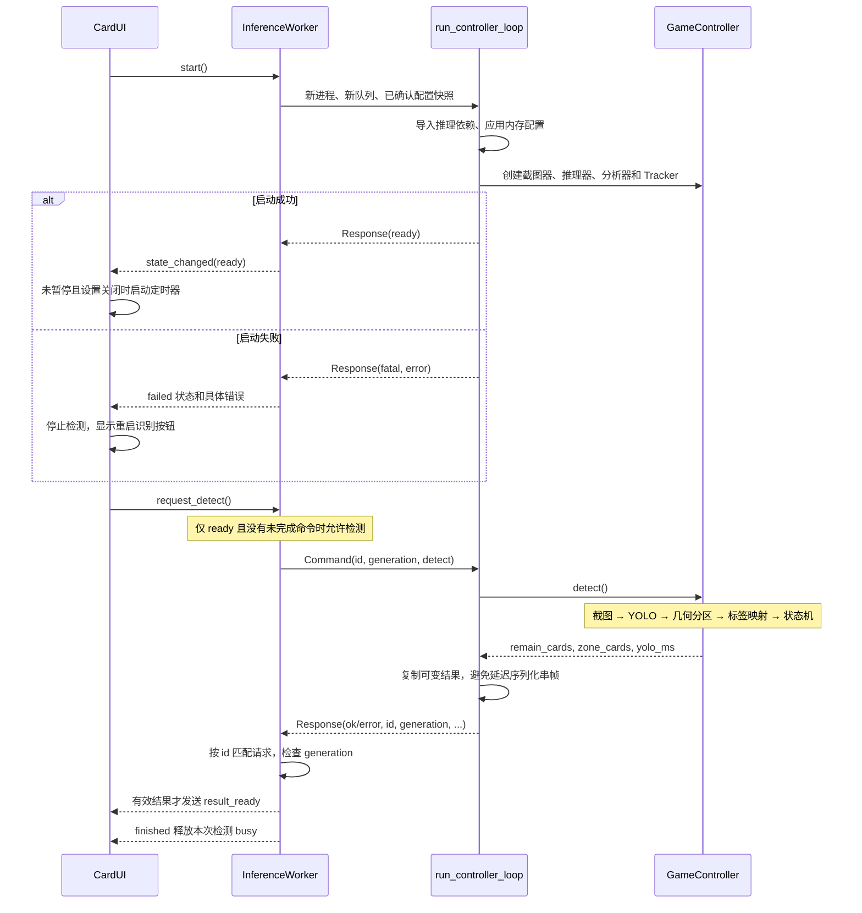
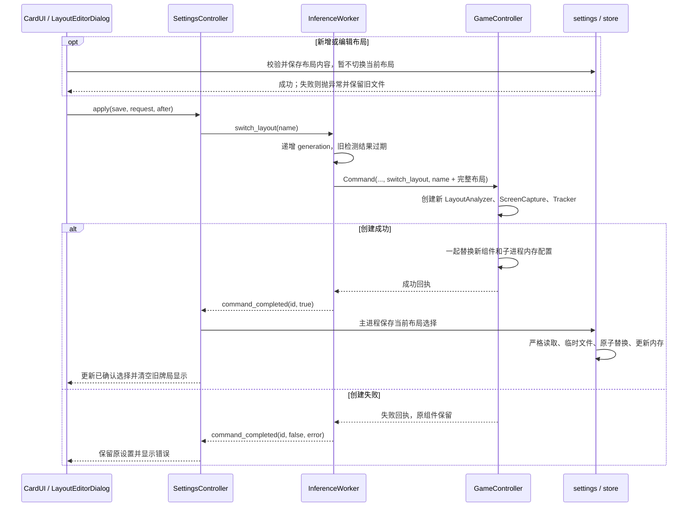
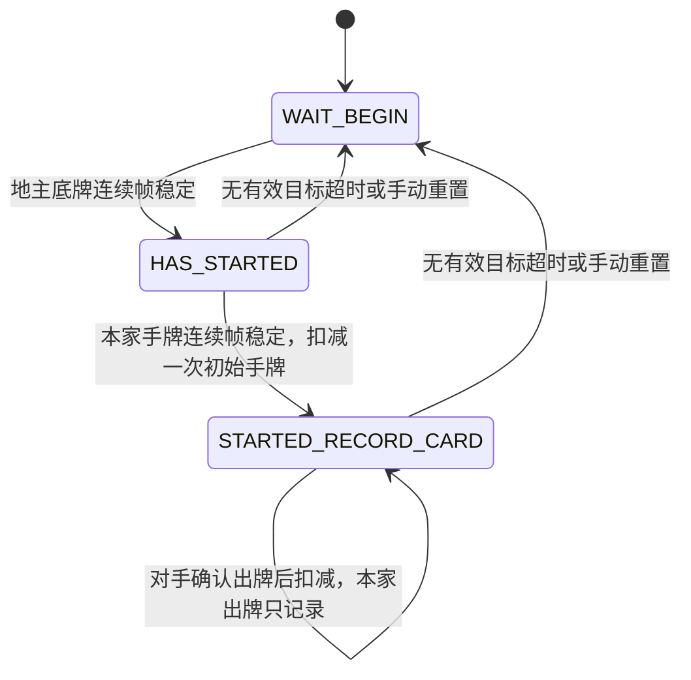

# 顺序图 - Han记牌器

当前范围为斗地主。进程协议见 `core/inference_protocol.py`，子进程入口见 `core/controller_process.py`。

## 1. 启动与检测

## 2. 设置和布局切换

设备、模型和热更新设置使用相同的确认与保存流程。模型切换同时重建 Tracker，设备切换保留 Tracker。后端已成功但主进程保存失败时进入故障状态，停止新检测；修正配置后手动重启。

## 3. 重置和恢复

- 重置通过带请求编号的命令执行；提交时递增 generation，旧检测结果不能覆盖重置后的显示。
- 重置成功后立即清空牌数与出牌文本，包括暂停状态。
- 检测进程意外退出（包括退出码为零）或通信失败时，Worker 进入 failed，UI 停止定时器。
- “重启识别”关闭旧进程及旧队列，清空未完成命令，使用主进程已确认配置创建全新会话。
- 恢复后重新初始化牌局；若用户此前暂停，服务就绪后仍保持暂停。
- 服务故障时可先在设置中修正设备、模型、布局等持久化配置，再点击重启。

## 4. 斗地主状态机

本家手牌统计口径及识别时序边界见 [斗地主记牌设计说明](斗地主记牌设计说明.md)。
