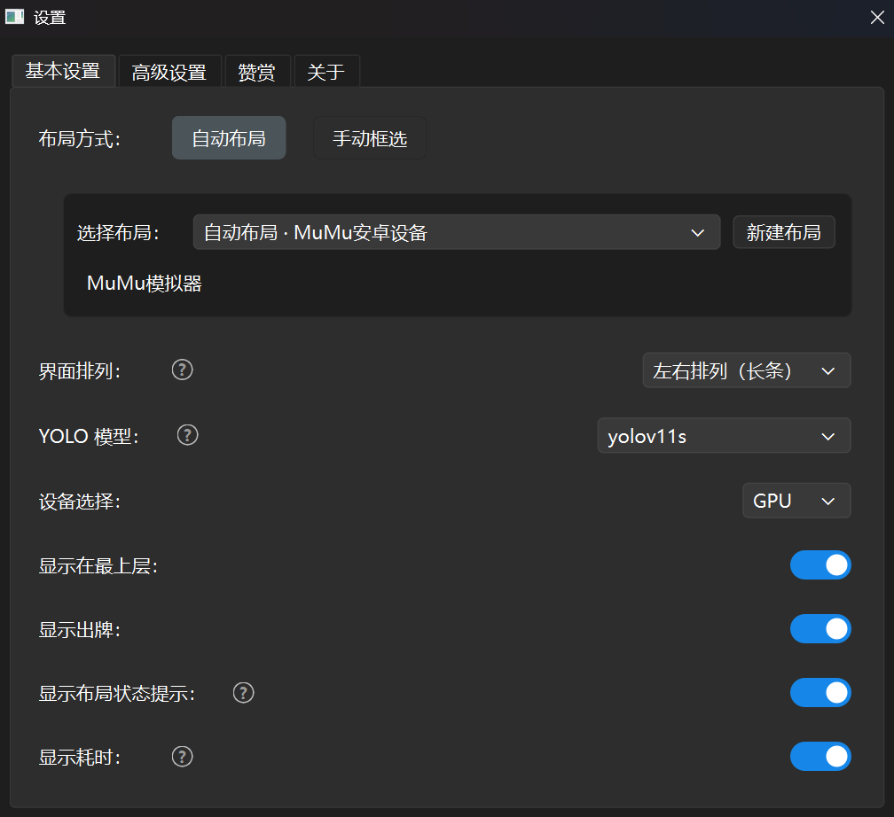
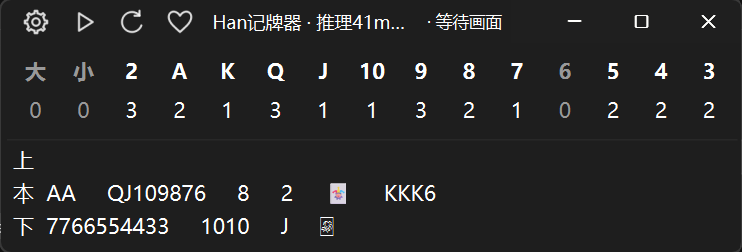
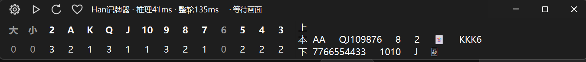

# 安装与使用

[文档目录](README.md) · [配置参考](配置参考.md) · [问题排查](排查与验证.md)

普通使用建议选择 EXE；需要修改代码时，再按第二部分从源码运行。两种方式的界面操作相同。

## 一、EXE 使用

### 下载与启动

在 [GitHub Releases](https://github.com/hey-three/han-card-tracker/releases/tag/v4.3.3) 选择适合自己的 Windows 版本：

| 版本 | 下载 | 适用情况 |
|---|---|---|
| CPU版 | [Windows CPU](https://github.com/hey-three/han-card-tracker/releases/download/v4.3.3/HanCardTracker-v4.3.3-Windows-CPU.zip) | 不使用显卡，体积较小 |
| CPU/GPU版 | [Windows CPU/GPU（7z）](https://github.com/hey-three/han-card-tracker/releases/download/v4.3.3/HanCardTracker-v4.3.3-Windows-CPU-GPU.7z) | 可选CPU或兼容CUDA的NVIDIA显卡，包体积较大 |

1. 下载 Windows 发布包，完整解压到可以写入文件的文件夹。CPU版是ZIP，CPU/GPU版为满足GitHub附件上限使用7z格式，可用[7-Zip](https://www.7-zip.org/)解压。
2. 双击包内的 EXE，保留随包附带的模型、配置和其他目录，无需自行安装 Python 依赖。
3. 打开游戏窗口，尽量在一局开始前启动记牌。游戏窗口不要最小化。

首次加载模型可能较久，看到顶部加载提示时稍等即可。

### 选择游戏窗口

点击记牌器左上角的**齿轮 → 基本设置**，按需要选择一种布局方式。



**自动布局：** 点击“新建布局”，选择游戏窗口，给布局命名，再点“保存并使用”。以后可直接选择已保存的布局，不需要每次重新寻找窗口。

**手动框选：** 点击“新建布局”，截取游戏画面，依次框选**本家手牌、本家出牌、上家出牌、下家出牌、地主底牌**五个区域，再保存。框要覆盖完整牌面，包括可能出现的第二行；程序不会向框外补抓。

手动布局可以选择“原图检测”或“拼图检测”。如果拼图漏牌，可先切换原图对比；自动布局始终使用原图。布局列表里的铅笔用于编辑，垃圾桶用于删除。

当前模型用原图训练，建议优先原图检测。框选大小王时要包含竖排J、O、K三个字母，不能只框住J或J、O。

自动和手动分别记住上次使用的布局，点击即切换并保存。仓库附带的布局不一定适合你的窗口，首次使用请选择或新建自己的布局。

### 看懂记牌器

在“基本设置 → 界面排列”中选择上下或左右排列，切换不会清空本局记录。

**上下排列：** 上面是剩余牌数，下面是出牌历史。



**左右排列：** 左边是剩余牌数，右边是出牌历史，适合放在屏幕边缘。



剩余牌数表示：**整副牌 − 你的首次确认手牌 − 对手已确认打出的牌**，不是三位玩家各自还剩多少张。“上、本、下”分别表示上家、本家和下家的出牌历史。

| 顶部按钮 | 操作 |
|---|---|
| 齿轮 | 打开设置；后台仍继续识别 |
| 暂停／播放 | 暂停或继续识别 |
| 圆形箭头 | 重置本局记录 |
| 爱心 | 打开赞赏页 |

底牌出现且手牌稳定确认后开始记牌。请核对第一次手牌是否识别完整。上一局结束后会保留旧记录，下一局确认开局时再刷新。

### 常用设置与问题排查

| 位置 | 设置与用途 |
|---|---|
| 基本设置 | 选择 YOLO 模型和 CPU／GPU；没有可用 NVIDIA 显卡时选 CPU |
| 基本设置 | 调整界面排列、置顶、显示出牌、耗时和布局状态提示 |
| 高级设置 → 实时显示 YOLO 输入 | 查看实际送去识别的原图或拼图；“上、下、本、底、手”标示区域 |
| 高级设置 → 完整诊断 | 排查错误时保存图片和逐帧记录；日常使用可关闭，并可设置诊断磁盘上限 |

**YOLO 预览和完整诊断独立开关。** 仅打开预览不会保存完整诊断材料。若截图不完整或提示“桌面回退”，请让游戏完整显示，并把遮挡它的窗口移开。

其他参数一般先保持默认。更详细的说明见[配置参考](配置参考.md)；识别出错时可按[诊断记录](诊断记录.md)保留材料。顶部故障提示可悬停查看原因。

随时可以从“设置 → 关于 → 使用说明”返回本页；关于页也提供项目主页和联系邮箱：jiangfan0519@qq.com。

## 二、从源码运行

### 安装依赖

准备 **Windows 和 Python 3.11（64位）**，下载并解压[源码 ZIP](https://github.com/hey-three/han-card-tracker/archive/refs/heads/main.zip)，在含有 `main.py` 和 `requirements.txt` 的文件夹打开 PowerShell，依次运行：

```powershell
py -3.11 -m venv .venv
.\.venv\Scripts\python.exe -m pip install -r requirements-cpu.txt
.\.venv\Scripts\python.exe main.py
```

无需激活环境。以后启动只运行最后一行即可，界面操作按上面的 EXE 使用部分进行。

上述安装CPU依赖。如需GPU，将第二行换成 `.\.venv\Scripts\python.exe -m pip install -r requirements.txt --extra-index-url https://download.pytorch.org/whl/cu121`，使用 CUDA 12.1 版 PyTorch，版本依据 [PyTorch 官方说明](https://pytorch.org/get-started/previous-versions/)。GPU 是否可用取决于显卡和驱动。安装失败时，请附上完整报错到[问题反馈](https://github.com/hey-three/han-card-tracker/issues)。

### 模型放在哪里

使用仓库自带模型时，直接在基本设置中选择。添加自己的模型时，把 `best.pt` 和 `model_config.yaml` 放在同一个模型子目录，配置填写真实输入尺寸：源码目录是 `yolo/weights/<模型名称>/`，EXE发布包内是 `_internal/yolo/weights/<模型名称>/`。详见[模型与训练约定](模型训练与拼图约定.md)。
