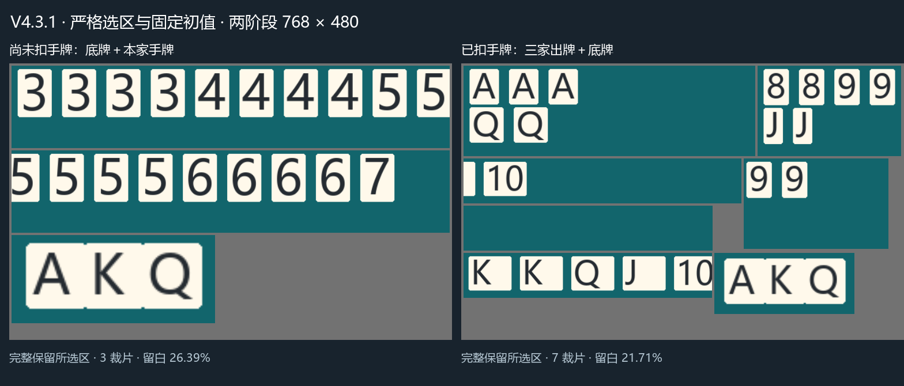

# 两阶段拼图、严格选区与自适应缩放

[文档目录](README.md) · [架构](架构与数据流.md) · [设计取舍](设计决策.md) · [验证记录](排查与验证.md)

## 1. 用户确认的范围

- 玩家框选的位置和范围就是裁剪范围。不按检测结果扩框，不补四周1%或下沿余量，不寻找或补救框外漏掉的牌。玩家负责选区覆盖。
- 归一化框转换为整数像素时向内取整；只用1e-7像素容差消除序列化浮点误差。不读取框外的完整像素，少于一个完整像素的框报错。
- 允许把框内的长条切开，并在该框内部重叠保护；不越过原用户框，不把多个框扩成大包围框。
- 固定的是输出画布宽768×高480，各片按自己的缩放权重等比绘制，不旋转、不拉伸。排列由当前布局和当前阶段决定，不是固定位置模板。

## 2. 初始比例固定，之后才学习

首次采用固定比例，底牌未识别时保持比例等待。初始权重集中在 config/packing_profile.py 的 INITIAL_REGION_SCALES：

| 区域 | 初始相对权重 |
|---|---:|
| 底牌 | 1.652110 |
| 本家手牌 | 0.703958 |
| 上家出牌 | 1.000212 |
| 下家出牌 | 1.002385 |
| 本家出牌 | 0.836045 |

这是同一套裁片装入画布前的相对权重，不是最终像素倍率；整套还要共同缩放。没有先整图推理的校准步骤。

在线学习由 core/packing_scales.py 的 AdaptivePackingScales 实现：

1. 从当前拼图的YOLO结果恢复原图坐标，根据当前用户区域分配单牌框；不是根据大区域的宽高估计牌大小。
2. 每区每帧计算普通单牌框高度的中位数，除以原图高归一化。大小王纵长字样不参与普通牌尺度参照。
3. 每区连续三帧有普通牌，且最高/最低高度不超过1.2，才确认测量；空区、未知或失败中断未确认序列。已确认尺度可保留。
4. 未测准底牌或没有可用参照时，仍保持固定初始比例。只有手牌被识别到、底牌仍未检出时不会暗中反复加大底牌。
5. 已测准后，参照优先取三家已观测出牌的普通单牌高度中位数；没有出牌时使用手牌高度。权重=参照高/本区单牌高；底牌再乘1.12。尚未测准的其他区继续用初始权重。
6. 确认高度变化超过10%才更新，权重限制在0.25～8，避免异常框导致极端尺寸。尺度变化可重建规划，稳定时复用规划与画布；不缓存旧识别结果。
7. 布局、截图尺寸、模型、显式重置或检测方式切换清除本次尺度学习。开局二区切到记牌四区保留已经测到的手牌和底牌参照；未参与区域不当作空区。

学习只使用已经进行的推理，不另跑全图或另加一个模型；最初识别不到底牌就不会开局。检测质量不足时无法凭空得到真实比例，不承诺所有皮肤自动测准。

## 3. 开局前始终两区

手动拼图模式：

- WAIT_BEGIN/HAS_STARTED：从第一张有效截图就拼底牌+手牌。没有底牌、两区全空或模型结果未知，都不再因这些原因推理整张原图。不可靠的切口结果等待下一帧，预览仍是当次实际输入。
- 任意一张底牌即可开局；手牌非空合法且稳定后只扣一次；扣完后的下一张截图改拼底牌+三家出牌，不再包含手牌。
- STARTED_RECORD_CARD：底牌缺失或切口/类别冲突仍可复查同一原图，以降低误结束；一张截图只推进一次状态机。
- 底牌持续消失的结束阈值、保留历史至下次底牌出现、V3非空稳定手牌一次扣减均不改变。

Tile.source_region 保存每片属于哪个原用户框。贴用户外边界的识别框按用户范围裁回，不当作算法内部切口。只有内部切口残片需要完整副本和去重检查；框外的牌是否完整不由算法保证。

## 4. 手动布局支持两种检测方式

设置 → 高级设置 → 手动布局检测方式：

- 拼图检测：上述二区/四区流程。
- 原图检测：直接推理完整截图，按同一手动布局分区和现有记牌状态机处理。

这是所有手动布局共用的全局偏好 packed_inference / PACKED_INFERENCE，自动布局始终整图。缺省为拼图；已有配置的布尔值继续有效。后端成功回执后才原子保存，重开设置显示已保存值；后端拒绝则恢复原选择。保存失败沿用现有停止检测并报告原因的契约，不能假报成功。切换只重建拼图缓存和尺度学习，不重置牌数或重复扣手牌。

预览仍显示最后一次真正传给YOLO接口的PIL图；选择原图时显示原图，选择拼图时显示拼图，记牌中异常复查则显示原图。静态ONNX/TensorRT的内部输入尺寸仍由已导出模型决定。

## 5. 示例与验证

[当前规划与面积](assets/v431-current/plans.json)记录矩形及方形对照。该示例只展示固定初始比例；当前用户的区域和学习后的排列可能不同。

覆盖、边界哨兵像素、切口、尺度学习、两区等待、切换和保存回归，以及162项测试和42次模型调用的边界，统一见[排查与验证](排查与验证.md)。
