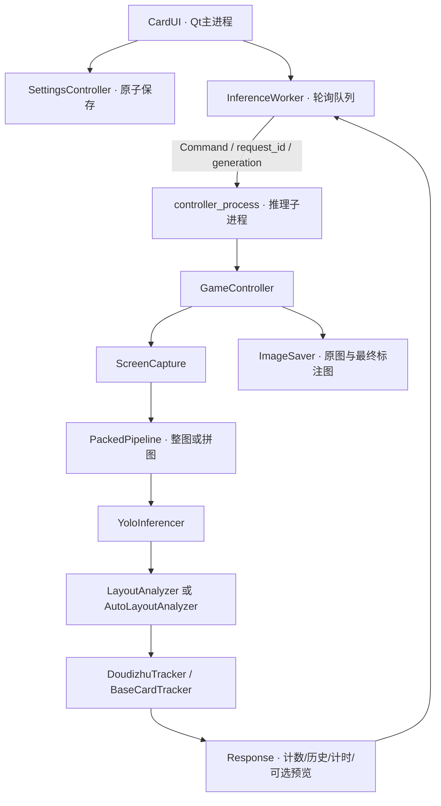

# 架构与数据流

[文档目录](README.md) · [计数规则](斗地主记牌设计说明.md) · [拼图](拼图自适应与检测方式.md)

## 进程边界

入口main.py创建QApplication并调用multiprocessing.freeze_support。YOLO在独立进程运行，不操作Qt对象；主进程Worker每20ms轮询回执，UI仅在发送成功后进入busy，避免故障后永久锁住。

## 一次检测

1. 捕获窗口，得到PIL原图或失败None。
2. 根据布局及手动偏好选择整图或拼图。手动拼图按状态选两区/四区，规划缓存只存几何与画布，每帧重新识别。开局不因无底牌去跑整图。
3. 拼图结果恢复原坐标并去重；自动模式按牌组学习归属，手动模式仅解析当前阶段所选区。
4. 模型类别映射为业务牌点，已知/空/未知区域分别传递。
5. Tracker按底牌门禁、连续帧和一次扣牌规则更新。预览在路线确定后编码真实last_input；调试保存使用原图及最终原坐标标注。
6. 对计数、历史、performance深拷贝后入队。预览关闭时不编码、不传图。

## 命令、代次与回执

协议在core/inference_protocol.py。Command包含request_id、generation、name和payload；reset和配置切换递增代次，旧结果丢弃。switch_layout必须携带完整布局而非仅名称。ready/fatal负责启动，ok/error对应指定请求；finished不能替代设置回执或解锁其他检测请求。

Worker生命周期为stopped → starting → ready，故障进入failed。重启建立新进程与队列并初始化牌局，保留用户暂停选择。关闭时回收定时器和队列，不向已死进程等待输送残留命令。

## 关键模块

| 模块 | 职责 |
|---|---|
| core/game_controller.py | 编排和最终结果一致性 |
| core/controller_process.py / inference_process.py | 子进程入口与主进程Worker |
| core/packed_pipeline.py | 路线、输入图、缓存、恢复及阶段回退 |
| core/square_packing.py / frame_packing.py | 装箱、Tile映射、人工边界与内部切口、去重 |
| core/packing_scales.py | 当前单牌框的尺度学习 |
| core/layout_analyzer.py / auto_layout.py | 手动区域与自动牌组归属 |
| core/games/doudizhu.py / base_tracker.py | 底牌门禁、帧确认与扣牌 |
| core/image_saver.py | 现有成对帧保存与清理 |
| config/settings.py / store.py | 校验、内存设置和原子持久化 |
| ui/settings_controller.py | 后端确认、保存与失败反馈 |

## 后端与计时

CPU优先现有ONNX Runtime，失败回退PyTorch；CUDA优先TensorRT FP16，再回退PyTorch CUDA FP16。首次可能自动导出ONNX或TensorRT，具体依赖与兼容性需要实机验证。

动态/PT整图和正式拼图明确请求(H,W)=(480,768)；静态后端保留导出尺寸，尤其首帧直接拼图时不能被默认方形尺寸覆盖。PIL预览大小不等于所有静态引擎的实际张量大小。

yolo_ms包含本轮全部Ultralytics调用及内部预处理/后处理，包含必要回退；GPU计时前后同步。UI“整轮”包括截图、通信与轮询，不等于纯网络前向，也不等于物理屏幕已显示。

## 诊断旁路

run_controller_loop在配置校验后建立DiagnosticRecorder，并在finally关闭。日常JSONL日志只记录关键事件，按大小轮转。完整诊断开关才创建一个后台线程：识别线程在每次模型调用前复制输入，在调用后提取CPU结果，更新记牌后冻结状态及解释；后台编码PNG、绘制标注、哈希、配额清理和发布帧。

队列和正在写入的帧共同受名额/字节预算约束，复制前检查；故障暂停诊断，保留识别原有返回值/异常。diagnostic状态回执和diagnostic_status通知独立于命令完成，不影响busy/generation。UI按状态采集时间拒绝倒序通知。原有ImageSaver开关仍为同步旧功能，未被替代。

路径、schema、完成度和计时重叠见[诊断记录](诊断记录.md)。独立控制器测试不默认创建日志；真实进程入口负责注入服务。
