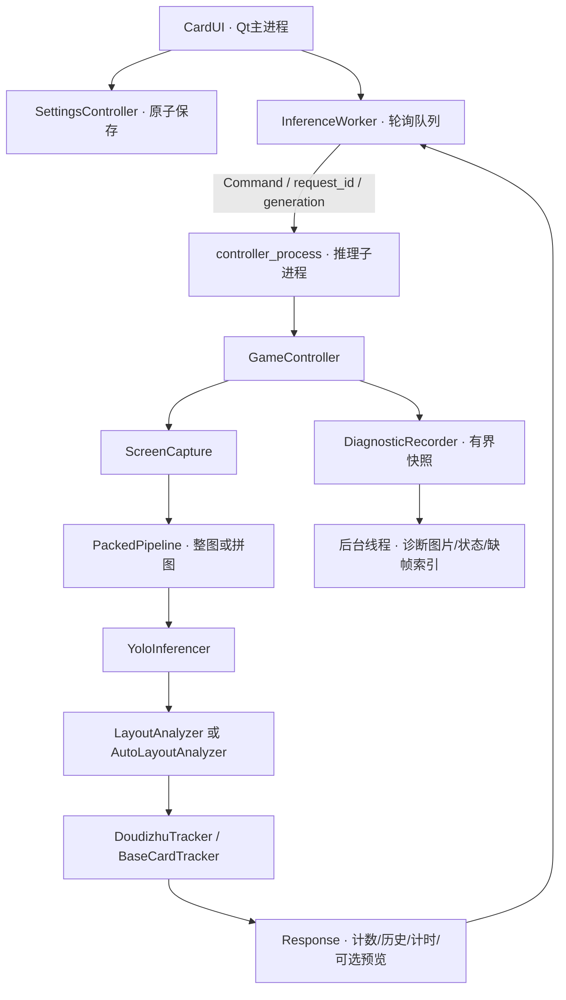

# 架构与数据流

[文档目录](README.md) · [计数规则](斗地主记牌设计说明.md) · [拼图](拼图自适应与检测方式.md)

## 进程边界

入口main.py创建QApplication并调用multiprocessing.freeze_support。YOLO在独立进程运行，不操作Qt对象；主进程Worker每20ms轮询回执，UI仅在发送成功后进入busy，避免故障后永久锁住。

## 一次检测

1. 捕获窗口，得到PIL原图或失败None。
2. 根据布局及手动偏好选择整图或拼图。手动拼图按状态选两区/四区，规划缓存只存几何与画布，每帧重新识别。开局不因无底牌去跑整图。
3. 拼图结果恢复原坐标并去重；自动模式按牌组学习归属，手动模式仅解析当前阶段所选区。
4. 模型类别映射为业务牌点，已知/空/未知区域分别传递。
5. Tracker按底牌门禁、连续确认和手牌首扣/对手扣牌更新，本家出牌仅记录。预览在路线确定后编码真实last_input；完整诊断在每次调用前冻结输入，更新后提交状态。
6. 对计数、历史、performance深拷贝后入队。预览关闭时不编码、不传图。

## 命令、代次与回执

协议在core/inference_protocol.py。Command包含request_id、generation、name和payload；reset和配置切换递增代次，旧结果丢弃。switch_layout必须携带完整布局而非仅名称。ready/fatal负责启动，ok/error对应指定请求；finished不能替代设置回执或解锁其他检测请求。

Worker生命周期为stopped → starting → ready，故障进入failed。重启建立新进程与队列并初始化牌局，保留用户暂停选择。关闭时回收定时器和队列，不向已死进程等待输送残留命令。

## 关键模块

| 模块 | 职责 |
|---|---|
| core/game_controller.py | 编排和最终结果一致性 |
| core/controller_process.py / inference_process.py | 子进程入口与主进程Worker |
| core/packed_pipeline.py | 路线、输入图、缓存、恢复及阶段回退 |
| core/square_packing.py / frame_packing.py | 装箱、Tile映射、人工边界与内部切口、去重 |
| core/packing_scales.py | 当前单牌框的尺度学习 |
| core/layout_analyzer.py / auto_layout.py | 手动区域与自动牌组归属 |
| core/games/doudizhu.py / base_tracker.py | 底牌门禁、帧确认与扣牌 |
| core/diagnostics.py / diagnostic_storage.py | 有界快照、后台保存与缺帧索引 |
| config/settings.py / store.py | 校验、内存设置和原子持久化 |
| ui/settings_controller.py | 后端确认、保存与失败反馈 |

## 后端与计时

CPU优先现有ONNX Runtime，失败回退PyTorch；CUDA优先TensorRT FP16，再回退PyTorch CUDA FP16。首次可能自动导出ONNX或TensorRT，具体依赖与兼容性需要实机验证。

有model_config.yaml时，core/model_input.py在模型加载时解析固定宽高，控制器将(W,H)交给拼图，YoloInferencer将(H,W)用于所有原图/拼图/复查及静态导出，预测rect=False。core/model_export_cache.py按权重内容、尺寸和环境隔离导出，首次截图前初始化并核对静态绑定，不跑整图校准。缺文件旧模型才沿用768×480动态请求/旧静态导出兼容路径。诊断model_input记录配置来源与请求尺寸，PIL预览不冒充网络张量；计时仍以实际调用为准。

yolo_ms包含本轮全部Ultralytics调用及内部预处理/后处理，包含必要回退；GPU计时前后同步。UI“整轮”包括截图、通信与轮询，不等于纯网络前向，也不等于物理屏幕已显示。

## 诊断旁路

run_controller_loop在配置校验后建立DiagnosticRecorder，并在finally关闭。日常JSONL日志只记录关键事件，按大小轮转。完整诊断开关才创建一个后台线程：识别线程在每次模型调用前复制输入，在调用后提取CPU结果，更新记牌后冻结状态及解释；后台编码PNG、绘制标注、哈希、配额清理和发布帧。

队列和正在写入的帧共同受名额/字节预算约束，复制前检查；队列/内存压力进入backpressure并跳过诊断帧，后台继续排空，低水位自动恢复；跳过区间写入索引。有缺帧会话不能标为complete。磁盘/数据格式故障仍暂停，保留识别原有返回值/异常。diagnostic状态回执和diagnostic_status通知独立于命令完成，不影响busy/generation。UI按状态采集时间拒绝倒序通知。图片只由完整诊断后台保存，不再有同步保存链路。

路径、schema、完成度和计时重叠见[诊断记录](诊断记录.md)。独立控制器测试不默认创建日志；真实进程入口负责注入服务。

完整诊断在session内按Tracker开局边界建立waiting/game_XXXX子目录；冻结局号随帧入队，开局元数据按帧序处理，防止延迟旧帧串局。磁盘配置diagnostic_disk_gib经白名单、后端回执和原子保存生效；主识别线程只更新目标额度，保存线程扫描并清理已封口旧材料，保护当前局。详见[诊断记录](诊断记录.md)。

## 布局编辑与标题栏展示

记牌器显示排列由panel_arrangement持久化，CardUI复用牌数/出牌两个QFrame，通过QBoxLayout方向切换上下和左右。此操作只在主进程保存与重排，不向Worker发送配置或重置命令。两区保持相同底色，由PlayedCardsPanel的arrangement动态属性选择顶部横线或左侧竖线，不绘制外框或圆角；切换排列后重刷样式，隐藏出牌区时分隔线一起隐藏。左右模式两区使用相同最小宽度和1:1伸缩系数，默认总宽900逻辑像素；压缩上下内边距和行距，高度下限80但仍尊重内容最小高度。上下模式保留原边距与高度规则。首显阶段与后续重显分开：_initial_size_pending允许showEvent收拢，并在现有标题栏子QTimer回调中补算一次最终高度，避免保留创建期临时尺寸；标记在resize前清除，后续重显继续保护用户尺寸。历史标签保留归属，长记录在区域内显示并提供完整悬停提示。

自动布局LayoutObservation.as_boxes按既有group_rows进行空间阅读排序，手动LayoutAnalyzer按行及左沿读取；不再按YOLO类别名称输出。Tracker的连续确认和重复牌判断分别用Counter比较，因此展示可以保留原画面顺序，同时保持换行防重扣与空区过渡规则。

布局状态在UI侧由ui/layout_status.py缩写，完整后台信息仍保留，未改定位或记牌判定。普通提示显示在MainTitleBar耗时后，更新只触及标题栏；诊断暂缓/恢复也只更新标题栏，暂缓时优先显示“诊断暂缓”及完整原因悬停提示，恢复后回显当前布局。所有故障、诊断持久暂停和日志写入错误也统一显示在顶部；识别异常优先，详情合并并存告警，关闭普通布局提示不隐藏异常。MainTitleBar内提供故障重启按钮。主窗口不创建QStatusBar，并接管StatusTip以阻止Qt隐式创建底栏；状态变化不重新计算窗口尺寸。ui/icons.py统一绘制主题适配的无填充细线图标。主窗口保留扩展客户区与原有标题层裁剪，但关闭NoTitleBarBackgroundHint，让右侧按钮在不透明主题底色上合成悬停高亮，避免深色透明白色背景合成异常；原生控制操作不变。

手动列表的LayoutComboView在showEvent中把视口事件过滤器提升到Qt弹出容器之前，接管图标按下和松开，避免内置选项激活先消费松开事件；普通条目点击继续交给Qt。手动列表通过layout_edit_requested传递明确名称；新建不再误用当前活动布局。编辑器保存配置后自动刷新列表，对正在使用的同名布局也重新提交完整配置，后端确认后才发布选择与重置显示。列表activated信号支持用户重新选择同一项进行重交；程序刷新不产生切换请求。草稿只属于当前编辑会话及对应截图目标，同窗重新截图按归一化坐标保留，换窗不复用旧框。原始参考图由reference_store存到用户配置同目录layout_previews/，布局名哈希作为文件名，PNG内嵌名称和窗口标题身份，以同目录临时文件加os.replace原子替换。重开只读取当前布局/目标匹配的图片，五区从已保存配置恢复，不从图片推测。加载或截图只调整画布缩放，不再按图片尺寸resize/居中编辑器。参考图不写入运行配置、不进入后台推理或诊断配额，并由Git忽略。原来独立的预览弹窗仅重复标框和配置校验，现移除按钮、弹窗与标框辅助函数；保存直接调用同一五区/坐标校验，画布继续显示五框。
