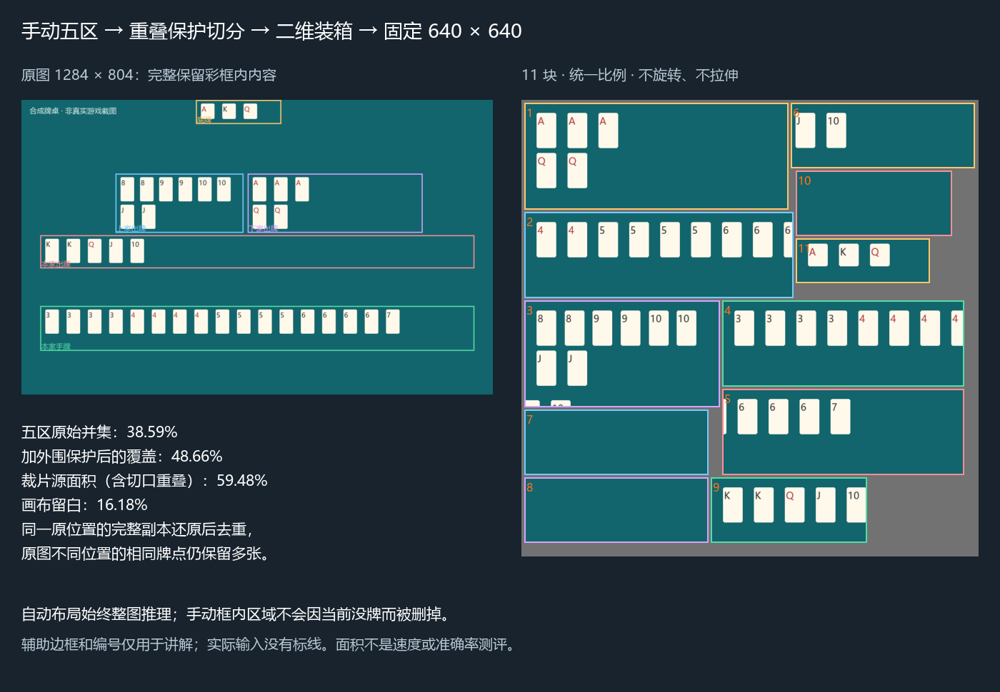

# 模型训练与拼图约定

更新日期：2026-10-27。本文件描述当前实现；自动布局的旧桌面带拼图已经退出运行链路。

## 当前路线

- 自动布局：从校准到跟踪始终使用整张截图，不拼图。
- 手动布局：使用用户框好的全部五区，固定生成 **640×640** 方形输入。框内当前没有牌也不删区，以保留将来出牌及第二行的位置。
- 同一模型实例可处理整图和拼图，不要求为每个区域训练不同模型。当前已有权重保持不变；本次没有训练、替换或重新导出模型。
- 动态/PyTorch 后端对拼图使用 640；静态 ONNX/TensorRT 沿用其已导出尺寸，不能仅凭画布 640 就宣称网络计算量下降。
- 旧 `packed_inference` 值只保留读写兼容，不能覆盖上述路线；界面已移除独立路线开关。

## 五区完整覆盖与方形装箱

`core/square_packing.py::make_square_plan()` 是当前正式规划器，独立实现，不包含参考 APK 的代码、模型或原生库。

1. 五个归一化矩形向外取整。四周额外保留 `max(2, ceil(min(W,H)×1%))` 源像素；下边额外保护为基础边距、`min(ceil(H×3.5%), ceil(区域高×25%))` 两者的较大值。源图边界处截断。旧手动框原本用于筛选中心点，这些余量用于保留框外的牌角上下文，尤其是竖排小王和向下的第二行。
2. 不删除框内像素；相交区域也不直接扩大成大包围矩形。宽长条生成 1 至最多 6 块的候选。相邻核心段完整衔接，单侧重叠不超过原图宽度 4% 及核心段半宽中的较小值，至少 1 像素。
3. 先按面积和最长边的必要下界筛选最多 64 套切分，额外切口副本面积不超过未切分源片面积的 30%；同时保留不切分候选。
4. 对每套尝试面积、长边、宽、高四种确定顺序，以 MaxRects 短边优先装箱，二分搜索所有裁片共享的缩放比例。优先扩大真实内容，随后减少重复面积和块数，不旋转、不分别拉伸图块。四周及图块间留 4 目标像素，空处填 RGB(114,114,114)。这是有界启发式，不保证数学最优，也不承诺任意布局都有相同留白率。
5. 规划按原图尺寸、全部区域及保护参数缓存；同布局下一帧只裁剪、缩放、粘贴并重新推理，复用 RGB 画布。尺寸、框或模型切换会重建，识别结果不缓存。

`Tile.project/unproject()` 使用实际整数渲染尺寸进行双向映射，取整误差小于一像素。跨块同类别且原图位置高度重合才去重；同点数的不同位置仍是多张牌。截短框只能作为残片：当另一块完整目标覆盖其至少 85% 面积时可丢弃，完整副本优先于残片可能错误的分类。完整框之间类别冲突、无唯一归属、缺完整副本等情况复查同一原图，不发布部分结果。空拼图必须整图复查，才能判断全图无牌。

几何上完整覆盖的是用户五个矩形及其保护余量；手工框本身遗漏了第二行或牌角，不能靠装箱算法补回任意框外内容。模型本身的漏检/误检仍须独立验证。手动分区直接比较原图归一化中心点，不再向内取整丢掉边缘目标。

## 实际示意与面积

[纯画布](assets/packing-fixed640.png) · [含控件框比例对照](assets/packing-controls-explained.png) · [完整数值和坐标](assets/packing-metrics.json)

| 指标（1284×804） | 全屏框比例示例 | 含控件框比例示例 |
|---|---:|---:|
| 原始五区并集 / 原图 | 38.59% | 34.13% |
| 加外围保护后的并集 / 原图 | 48.66% | 43.75% |
| 含切口重叠的裁片总面积 / 原图 | 59.48% | 53.96% |
| 未覆盖原图比例 | 51.34% | 56.25% |
| 640×640 画布未占用比例 | 16.18% | 15.52% |
| 裁片数 | 11 | 11 |
| 原图到画布的共同比例（取整后下界） | 0.7459 | 0.7854 |

重建：`python -B -m utils.preview_packing`。原图为合成牌桌，没有读取私人截图；辅助彩框和编号仅在讲解图出现。五区内原有的桌面背景不属于灰色填充，不能为了降低灰边数字而删除未来可能出牌的位置。

面积口径分开：源图并集说明删去了哪些原图内容；裁片总面积含保护重复；留白比例只算画布没有裁片占用的面积。三者均不等于速度或准确率。

## 训练建议（尚未执行）

先以 **YOLO11n、640×640、现有十五类牌面映射** 制作候选，与现有 YOLO11s 对照。最终网络选择按目标设备真实整轮 mean/P95、漏牌、重复牌与稳定开局率决定，不承诺 200 ms。

- 保留原图与五区配置；按牌局划分训练/验证/测试后，再用正式规划器生成拼图，避免同局近似帧泄漏。
- 混合原图及拼图数据，覆盖 17/20 张开局、两行长牌、切口重叠、大小王、淡色底牌、空桌、结算页和不同分辨率。
- 使用同一 Tile 映射变换标注。完整副本可分别标注，再由运行时还原去重；不能把只有残片的标注伪称完整牌。残片训练策略需标注验证。
- 裁片排列、画布大小和保护参数属于数据契约。修改后重新生成数据并验证；静态导出应与真正使用的输入一致，不在运行时偷偷重导出。
- 对照同帧原图和拼图的原图坐标结果。相同目标数量不证明识别正确；多出一个目标也不自动证明是恢复漏检。

## 验证与历史审计

新增自动测试验证全区域覆盖、无目标图块相交、切口及第二行同点数数量、坐标恢复、共享缩放、边缘中心点、规划缓存、原图回退与两种布局换局。真实 CPU 冒烟读取三张本地已有截图和现有 YOLO11s，六种图/布局组合各重复两次，均实际走拼图并可还原为原图 Results；原图输入 960 在拼图后恢复。匹配截图的含控件布局结果为 20/20、20/19、20/19（拼图/整图），后两张存在额外检测，未人工标注，不作为准确率通过或正式速度测试。私人截图和中间图位于忽略目录，不上传。

此前自动布局桌面带合成示意为 1000×800：原图并集 86.07%、含重叠 89.06%、640 画布灰边 35.38%，只裁掉 13.93% 原图。该审计揭示旧方案区域压缩不足；旧自动拼图路线已停用。其分辨率和区域与本节新例不同，不能直接把差值称为实测提速。
